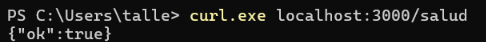
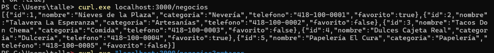
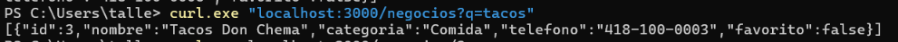
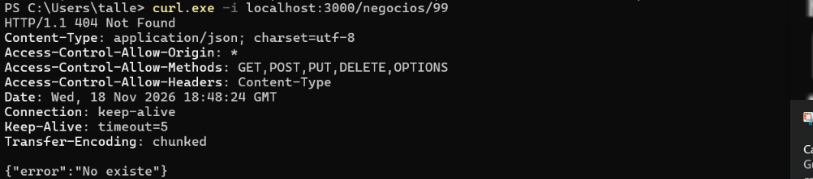
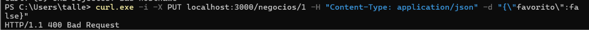
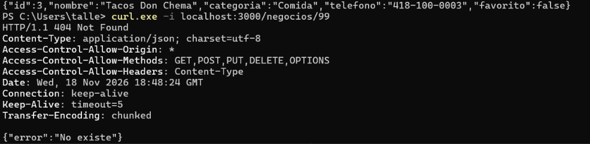
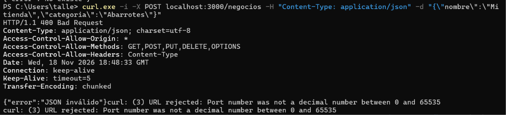
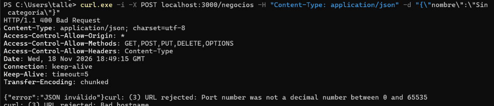
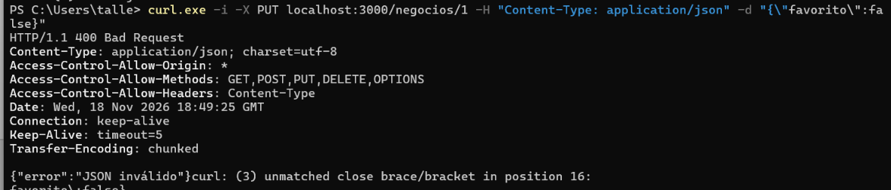

# Directorio de Negocios de Dolores Hidalgo · API local

API REST local escrita en Node.js con el módulo `http`, sin dependencias externas. Entrega el catálogo de negocios que consumirá la aplicación Flutter. Corresponde a la Ronda 1 del manual *TDD Consumo de API local*.

## Requisitos

- Node.js 18 o superior (`node --version`)
- Windows PowerShell, Mac o Linux
- Navegador web (opcional, para ver la lista en JSON)

## Ejecutar el servidor

```powershell
cd api
node server.js
```

Debe aparecer `API lista en http://localhost:3000/negocios`. Deja esa terminal abierta. Para detener el servidor usa `Ctrl + C`.

## Endpoints

| Método | Ruta              | Descripción                                               | Éxito | Errores  |
|--------|-------------------|-----------------------------------------------------------|-------|----------|
| GET    | `/salud`          | Verifica que el servidor esté activo                      | 200   |          |
| GET    | `/negocios`       | Lista los negocios. Acepta `?q=` para filtrar por nombre  | 200   |          |
| GET    | `/negocios/:id`   | Obtiene un negocio por id                                 | 200   | 404      |
| POST   | `/negocios`       | Crea un negocio. Requiere `nombre` y `categoria`          | 201   | 400      |
| PUT    | `/negocios/:id`   | Actualiza un negocio existente                            | 200   | 404, 400 |
| DELETE | `/negocios/:id`   | Elimina un negocio                                        | 204   | 404      |

Los datos se guardan en memoria: al reiniciar el servidor vuelven los 5 negocios iniciales.

## Pruebas

Las pruebas se hacen desde una **segunda terminal**, con el servidor encendido.

En Windows PowerShell, `curl` es un alias distinto. Usa `curl.exe` para las peticiones GET y para las pruebas de error. Para crear, actualizar y eliminar usa `Invoke-RestMethod`, que envía el JSON sin problemas de comillas.

### 1. Salud del servidor (200)

```powershell
curl.exe localhost:3000/salud
```

Respuesta esperada: `{"ok":true}`

### 2. Listar negocios (200)

```powershell
curl.exe localhost:3000/negocios
```

Respuesta esperada: los 5 negocios iniciales en JSON.

### 3. Buscar por nombre (200)

```powershell
curl.exe "localhost:3000/negocios?q=tacos"
```

Respuesta esperada: solo `Tacos Don Chema`.

### 4. Obtener un negocio por id (200)

```powershell
curl.exe localhost:3000/negocios/3
```

Respuesta esperada: el negocio con `id` 3.

### 5. Negocio inexistente (404)

```powershell
curl.exe -i localhost:3000/negocios/99
```

Respuesta esperada: `404 Not Found` con `{"error":"No existe"}`.

### 6. Crear un negocio (201)

```powershell
Invoke-RestMethod -Method Post -Uri http://localhost:3000/negocios -ContentType 'application/json' -Body '{"nombre":"Mi tienda","categoria":"Abarrotes"}'
```

Respuesta esperada: el negocio creado con `id` 6, `telefono` vacío y `favorito` en `False`.

### 7. Crear sin categoría (400)

```powershell
Invoke-RestMethod -Method Post -Uri http://localhost:3000/negocios -ContentType 'application/json' -Body '{"nombre":"Sin categoria"}'
```

Respuesta esperada: error `400 Bad Request` con el mensaje `nombre y categoria son obligatorios`.

### 8. Actualizar un negocio (200)

```powershell
Invoke-RestMethod -Method Put -Uri http://localhost:3000/negocios/1 -ContentType 'application/json' -Body '{"favorito":false}'
```

Respuesta esperada: el negocio 1 con `favorito` en `False`.

### 9. Eliminar un negocio (204)

```powershell
Invoke-RestMethod -Method Delete -Uri http://localhost:3000/negocios/6
```

Respuesta esperada: sin contenido. Este comando solo funciona si la prueba 6 creó el negocio con id 6.

### 10. Confirmar el borrado (404)

```powershell
curl.exe -i localhost:3000/negocios/6
```

Respuesta esperada: `404 Not Found`.

### Nota sobre los errores 400 con curl en PowerShell

Si envías JSON con `curl.exe -d "{\"nombre\":...}"` en PowerShell, las comillas se pierden y el servidor responde `400 JSON inválido`. Eso no es un fallo de la API: el cuerpo llega mal formado. Por eso las pruebas de creación y actualización usan `Invoke-RestMethod`.

Mientras pruebas, la terminal del servidor imprime cada petición (método y ruta). Es útil para verificar que la petición llegó.

## Estructura del proyecto

```
directorio_dolores/
├── api/
│   └── server.js
└── docs/
    └── capturas/
```

## Capturas

Las evidencias están en `docs/capturas/`.

### Captura 1 · Salud del servidor


### Captura 2 · Listar negocios


### Captura 3 · Buscar por nombre


### Captura 4 · Negocio inexistente (404)


### Captura 5 · PUT con curl en PowerShell (400)
Muestra el error de comillas descrito en la nota de arriba. La API responde 400 porque el cuerpo llega mal formado.


### Captura 6 · 404 con el servidor encendido


### Captura 7 · POST con curl en PowerShell (400)
Mismo caso: el JSON llega roto por las comillas. Las pruebas corregidas usan `Invoke-RestMethod`.


### Captura 8 · POST sin categoría (400)


### Captura 9 · PUT con curl en PowerShell (400)
Segundo intento del PUT con el mismo problema de comillas.


## Limitaciones

- Los datos viven en memoria. Al reiniciar el servidor se restauran los 5 negocios iniciales.
- Pensada para desarrollo local. No incluye autenticación ni HTTPS.
