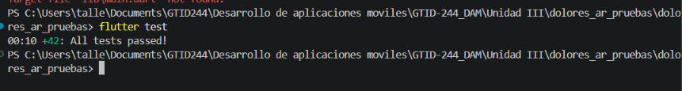
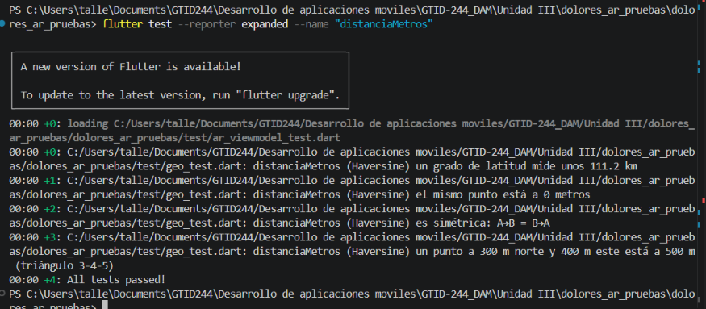
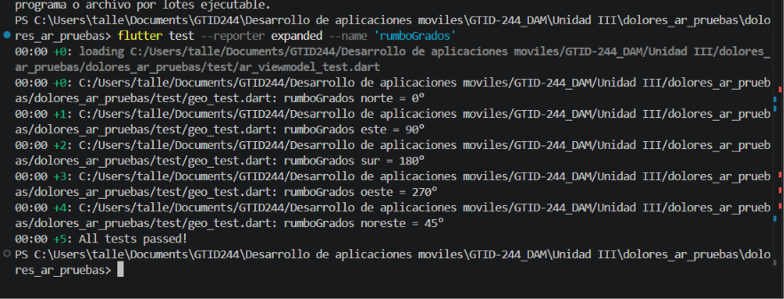
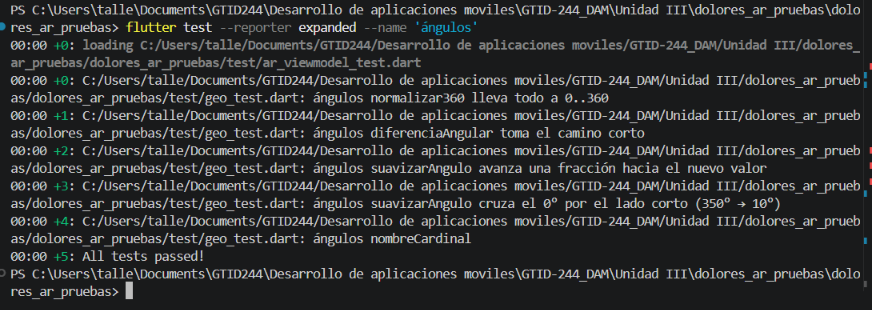
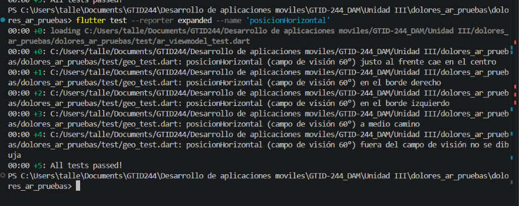
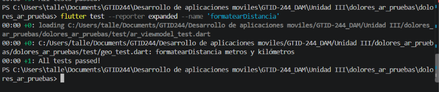
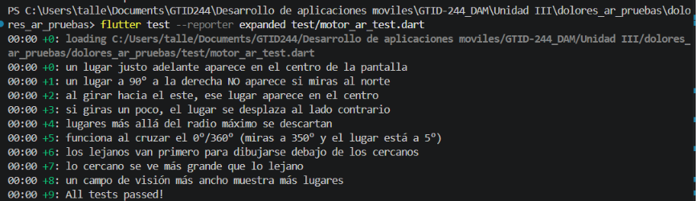
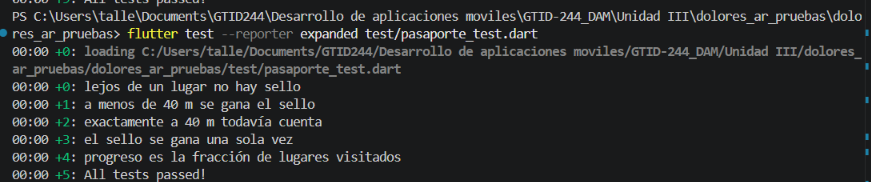
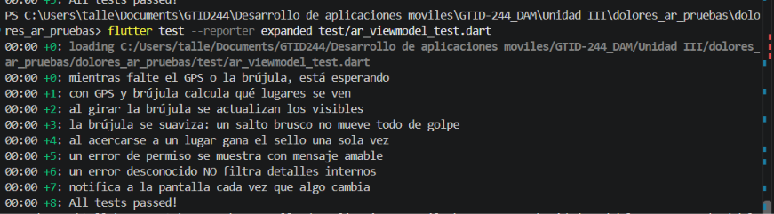
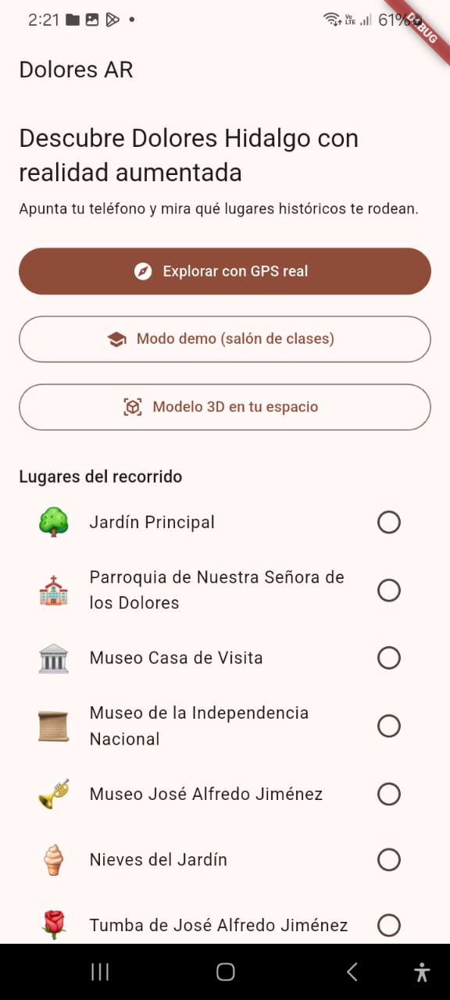

# Dolores AR · Turismo con realidad aumentada en Dolores Hidalgo

Aplicación Flutter que muestra, sobre lo que ve la cámara, los lugares históricos y culturales de Dolores Hidalgo, Guanajuato, con su distancia y su dirección. Incluye un pasaporte turístico con sellos al visitar cada lugar, y un modo demo para practicar dentro del salón sin salir a la calle.

Se desarrolla con TDD: en cada ronda primero se escriben las pruebas (rojo, deben fallar) y después el código mínimo para que pasen (verde). Corresponde al manual *Manual paso a paso con TDD · Dolores AR*, Desarrollo Móvil Integral, UTNG.

## Requisitos

- Flutter 3.x (`flutter --version`)
- Android con depuración USB, o Chrome/Edge para pruebas de escritorio
- Para la realidad aumentada: un teléfono real con GPS, brújula y cámara (los emuladores no tienen brújula)

## Ejecutar las pruebas

Desde la carpeta del proyecto (la que contiene `pubspec.yaml`):

```powershell
flutter pub get
flutter test
```

Debe terminar con `All tests passed!` y 42 pruebas en verde.

Para ver las pruebas de una ronda en particular:

```powershell
flutter test --reporter expanded --name 'distanciaMetros'
flutter test --reporter expanded --name 'rumboGrados'
flutter test --reporter expanded --name 'ángulos'
flutter test --reporter expanded --name 'posicionHorizontal'
flutter test --reporter expanded --name 'formatearDistancia'
flutter test --reporter expanded test/motor_ar_test.dart
flutter test --reporter expanded test/pasaporte_test.dart
flutter test --reporter expanded test/ar_viewmodel_test.dart
```

## Ejecutar la app

```powershell
flutter run -d ID_DEL_DISPOSITIVO
```

El id se obtiene con `flutter devices`. En la pantalla de inicio hay tres opciones: **GPS real** (usa tu ubicación y tu brújula), **modo demo** (te coloca en la Plaza Principal y un deslizador simula el giro) y **modelo 3D** (coloca un modelo sobre el piso o una mesa con ARCore).

## Arquitectura

Las matemáticas y las reglas viven en `dominio/`, sin depender de Flutter. Los datos del teléfono (GPS, brújula) se conectan mediante contratos, lo que permite probar la lógica sin salir a la calle.

```
lib/
├── dominio/
│   ├── geo.dart           distancia Haversine, rumbo, ángulos, campo de visión
│   ├── lugar.dart         modelo de un lugar
│   ├── catalogo.dart      7 lugares de Dolores Hidalgo
│   ├── motor_ar.dart      qué se ve, en qué posición y con qué tamaño
│   ├── pasaporte.dart     sellos al llegar a menos de 40 m
│   ├── fuentes.dart       contratos: posición y brújula
│   └── excepciones.dart   errores con mensajes amables
├── datos/
│   ├── fuentes_reales.dart      GPS y brújula del teléfono
│   └── fuentes_simuladas.dart   modo demo
├── presentacion/
│   ├── ar_viewmodel.dart        estado de la pantalla de RA
│   ├── fondo_camara.dart        vista de la cámara con respaldo sin cámara
│   ├── pantalla_ar.dart         etiquetas sobre la vista
│   ├── pantalla_inicio.dart     menú y lista de lugares
│   └── pantalla_modelo3d.dart   RA de superficie
└── main.dart
```

## Pruebas y evidencias

Las capturas siguen el orden del desarrollo de cada ronda.

### Captura 1 · Corrida completa de las pruebas

`flutter test` ejecuta las 42 pruebas de las rondas 1 a 6 y todas pasan.



### Ronda 1 · ¿A qué distancia está?

### Captura 2 · Distancia con Haversine

El grupo `distanciaMetros` pasa sus 4 pruebas: un grado de latitud mide unos 111.2 km, el mismo punto está a 0 m, la distancia es simétrica y el triángulo 3-4-5 da 500 m.



### Ronda 2 · ¿Hacia dónde queda?

### Captura 3 · Rumbo

El grupo `rumboGrados` pasa las 5 pruebas: norte, este, sur, oeste y noreste.



### Captura 4 · Ángulos

El grupo `ángulos` pasa sus 5 pruebas, incluido el cruce por el norte: `suavizarAngulo(350, 10)` da 0° y no 180°.



### Ronda 3 · De ángulo a pantalla

### Captura 5 · Posición horizontal

El grupo `posicionHorizontal` pasa sus 5 pruebas: centro, bordes y lugares fuera del campo de visión de 60°.



### Captura 6 · Formato de distancia

`formatearDistancia` muestra metros hasta 999 m y kilómetros a partir de 1000 m.



### Ronda 4 · El motor de realidad aumentada

### Captura 7 · Motor AR

Las 9 pruebas de `motor_ar_test.dart` pasan: el lugar de frente aparece en el centro, los de atrás no se dibujan, funciona al cruzar el norte y los lejanos se dibujan antes que los cercanos.



### Ronda 5 · El pasaporte turístico

### Captura 8 · Pasaporte

Las 5 pruebas de `pasaporte_test.dart` pasan: no hay sello lejos, sí lo hay a menos de 40 m, y el sello se gana una sola vez.



### Ronda 6 · Fuentes de datos y ViewModel

### Captura 9 · ViewModel

Las 8 pruebas de `ar_viewmodel_test.dart` pasan, con fuentes falsas: espera el GPS y la brújula, calcula los lugares visibles, suaviza la brújula, da el sello una vez, y los errores no revelan detalles internos.



### Ronda 7 · La pantalla de realidad aumentada

### Captura 10 · Pantalla de inicio en el teléfono

La app corriendo en un dispositivo Android, con las tres opciones de inicio y la lista de los 7 lugares del recorrido.



## Estado del proyecto

- **Rondas 1 a 6:** completas, con sus pruebas automatizadas en verde.
- **Ronda 7:** código escrito y analizado sin errores (`flutter analyze`). La vista de la pantalla de RA y el modo demo están pendientes de verificar en el teléfono.
- **Ronda 8:** archivo de la pantalla 3D escrito, pendiente de probar.
- **Ronda 9:** pendiente. Requiere recorrido de campo para corregir las coordenadas del catálogo.

## Nota sobre datos

Las coordenadas de `catalogo.dart` son aproximadas y de práctica. La Ronda 9 del manual explica cómo corregirlas con un recorrido de campo.

## Estructura del repositorio

```
dolores_ar_pruebas/
├── README.md
├── docs/capturas/
├── lib/
├── test/
└── pubspec.yaml
```
