# Dolores Rally · Rally de la Independencia AR

Juego de realidad aumentada por Dolores Hidalgo, Guanajuato. El jugador busca a seis personajes de la Independencia escondidos en el centro histórico: un radar y un juego de "frío o caliente" lo guían, y para atraparlos tiene que acercarse y responder una pregunta de historia. El progreso se guarda en un álbum.

Se desarrolla con TDD: en cada ronda primero se escriben las pruebas (rojo, deben fallar) y después el código mínimo para que pasen (verde). Corresponde al *Manual TDD · Rally de la Independencia AR*, Desarrollo Móvil Integral, UTNG.

## Requisitos

- Flutter 3.x (`flutter --version`)
- Android con depuración USB para jugar en el teléfono
- Para jugar en la calle: teléfono con GPS, brújula y cámara

## Ejecutar las pruebas

Desde la carpeta del proyecto (la que contiene `pubspec.yaml`):

```powershell
flutter pub get
flutter test
```

Debe terminar con `All tests passed!` y 43 pruebas en verde.

Pruebas por ronda:

```powershell
flutter test --reporter expanded --name 'destino'
flutter test --reporter expanded --name 'aparicion'
flutter test --reporter expanded test/radar_test.dart
flutter test --reporter expanded test/motor_ar_test.dart
flutter test --reporter expanded test/partida_test.dart
flutter test --reporter expanded test/rally_viewmodel_test.dart
```

## Ejecutar el juego

```powershell
flutter run -d ID_DEL_DISPOSITIVO
```

En la pantalla de inicio hay tres opciones: **Jugar con GPS real**, **Modo demo (salón de clases)**, que coloca al jugador en el Jardín Principal y permite caminar con botones, y **Mi álbum**, con los personajes atrapados.

## Arquitectura

La lógica del juego vive en `dominio/`, sin depender de Flutter. Las fuentes de posición y brújula se conectan por contratos, así que el juego se prueba sin salir a la calle.

```
lib/
├── main.dart
├── dominio/
│   ├── geo.dart           distancia, rumbos, ángulos y destino (geodesia)
│   ├── personaje.dart     personajes y sus preguntas
│   ├── catalogo.dart      los 6 personajes y el punto de partida
│   ├── aparicion.dart     dónde se esconde cada personaje (azar con semilla)
│   ├── radar.dart         puntos del radar y temperatura "frío o caliente"
│   ├── motor_ar.dart      qué personajes se ven en la cámara
│   ├── partida.dart       reglas: distancia, intentos, puntos y huida
│   ├── almacen.dart       contrato del álbum
│   ├── fuentes.dart       contratos de posición y brújula
│   └── excepciones.dart   errores con mensajes amables
├── datos/
│   ├── almacen_prefs.dart       guarda el progreso en el teléfono
│   ├── fuentes_reales.dart      GPS y brújula del teléfono
│   └── fuentes_simuladas.dart   modo demo
└── presentacion/
    ├── rally_viewmodel.dart     estado del juego
    ├── fondo_camara.dart        cámara trasera con respaldo sin cámara
    ├── radar_widget.dart        radar dibujado con CustomPainter
    ├── pantalla_rally.dart      juego: personajes, marcador y preguntas
    ├── pantalla_coleccion.dart  álbum
    └── pantalla_inicio.dart     menú principal
```

## Rondas y evidencias

Cada ronda muestra su resultado en la terminal. Las capturas siguen el orden del desarrollo.

### Ronda 0 · Preparar el taller

Proyecto creado con sus dependencias (camera, geolocator, flutter_compass, shared_preferences), permisos de cámara y ubicación en Android, y `minSdk` en 21.

### Captura 1 · Taller listo

`flutter test` responde que todavía no hay archivos de prueba, lo esperado en la Ronda 0.

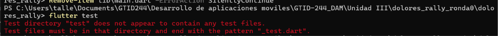

### Ronda 1 · Diseño del juego

Documento de diseño con las reglas: 6 personajes, captura a 15 m o menos, 2 intentos, 100 o 50 puntos, huida tras dos fallos, y la escala de temperatura.

### Ronda 2 · Geometría de la Tierra

Funciones de distancia (Haversine), rumbo, normalización de ángulos, diferencia angular, suavizado de la brújula, posición horizontal y el destino a partir de un rumbo y una distancia.

### Captura 2 · Rojo de la geometría

Las pruebas fallan porque `geo.dart` todavía no existe.

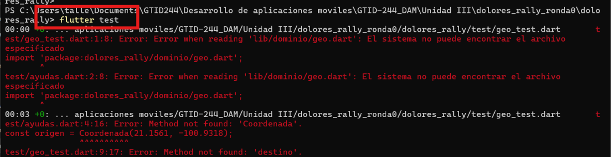

### Captura 3 · Verde de la geometría

Las 7 pruebas de geometría pasan.

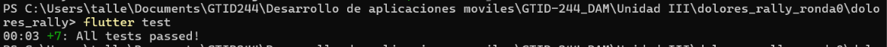

### Ronda 3 · Personajes y preguntas

Modelo `Personaje` con su `Pregunta` y el catálogo de los seis personajes de la Independencia. Esta ronda se verifica con el análisis del código y las pruebas anteriores.

### Captura 4 · Análisis del dominio

`flutter analyze lib\dominio` no reporta problemas y las 7 pruebas siguen en verde.

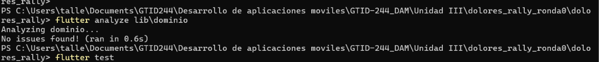

### Ronda 4 · Apariciones con azar repetible

Cada personaje aparece en un punto al azar entre 60 y 500 m del centro. Con una semilla fija el azar es repetible, lo que hace las pruebas confiables.

### Captura 5 · Rojo de las apariciones

Las pruebas fallan porque `aparicion.dart` no existe.

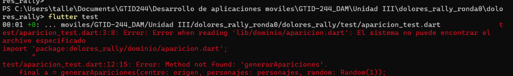

### Captura 6 · Verde de las apariciones

Las 12 pruebas acumuladas pasan.

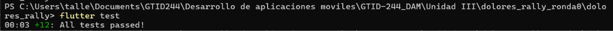

### Ronda 5 · Radar y "frío o caliente"

`puntoEnRadar` convierte cada personaje en un punto del radar, y `temperaturaPorDistancia` clasifica qué tan cerca está el jugador: helado, frío, tibio, caliente o ardiendo.

### Captura 7 · Rojo del radar

Las pruebas fallan porque `radar.dart` no existe.

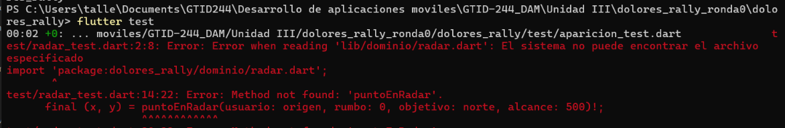

### Captura 8 · Verde del radar

Las 19 pruebas acumuladas pasan.

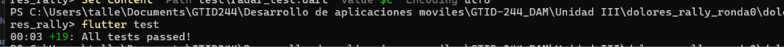

### Ronda 6 · Motor de realidad aumentada

`calcularVisibles` decide qué personajes caen dentro del campo de visión de 60°, con su posición horizontal, tamaño y orden de dibujo.

### Captura 9 · Rojo del motor

Las pruebas fallan porque `motor_ar.dart` no existe.

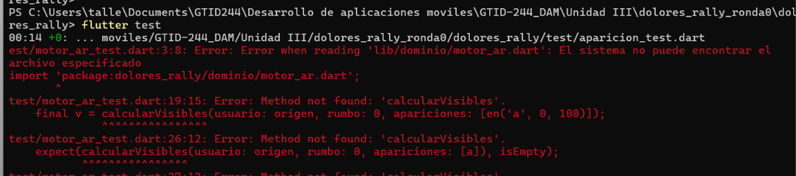

### Captura 10 · Verde del motor

Las 24 pruebas acumuladas pasan.

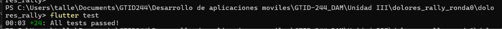

### Ronda 7 · Reglas de la partida

`Partida` aplica las reglas: captura a 15 m o menos, 100 puntos a la primera respuesta y 50 a la segunda, huida tras dos fallos, y no permite capturar dos veces al mismo personaje. Los resultados se modelan con una sealed class.

### Captura 11 · Rojo de las reglas

Las pruebas fallan porque `partida.dart` y `excepciones.dart` no existen.

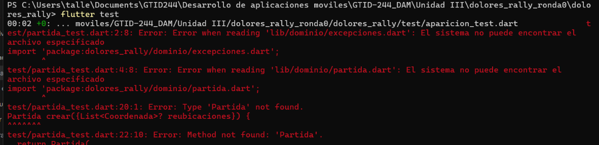

### Captura 12 · Verde de las reglas

Las 34 pruebas acumuladas pasan.

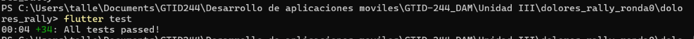

### Ronda 8 · Álbum y almacenamiento

Contrato `AlmacenColeccion` con dos implementaciones: `AlmacenMemoria` para pruebas y modo demo, y `AlmacenPrefs` para guardar el progreso en el teléfono. Solo se guardan ids y puntaje, nunca coordenadas del jugador.

### Captura 13 · Análisis del almacén

`flutter analyze` revisa los archivos nuevos del álbum.

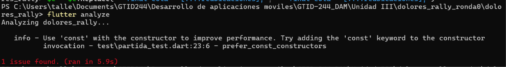

### Captura 14 · Pruebas después del almacén

Las 34 pruebas siguen en verde.

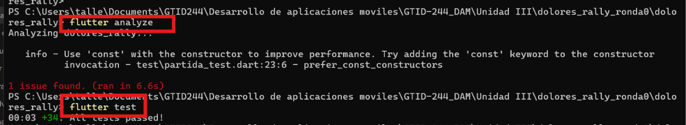

### Ronda 9 · Fuentes de posición y brújula

Contratos `FuentePosicion` y `FuenteBrujula`, con la versión real (GPS y brújula del teléfono) y la simulada (modo demo, con avance en metros y giro).

### Captura 15 · Análisis y pruebas de las fuentes

El análisis no reporta errores y las 34 pruebas pasan.

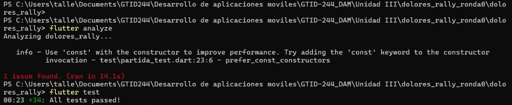

### Ronda 10 · ViewModel del juego

`RallyViewModel` escucha el GPS y la brújula, calcula lo visible, el radar y la temperatura, y ejecuta las capturas guardando el progreso. Las pruebas usan fuentes falsas y una semilla fija.

### Captura 16 · Rojo del ViewModel

Las pruebas fallan porque `rally_viewmodel.dart` no existe.

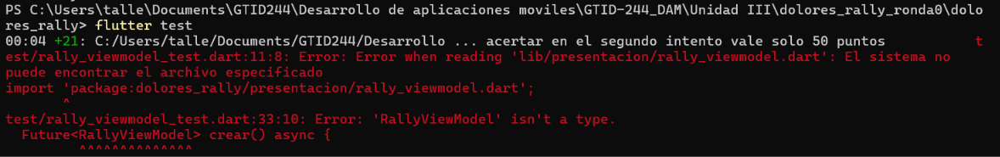

### Captura 17 · Verde del ViewModel

Las 43 pruebas del proyecto pasan.

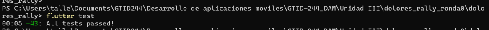

### Ronda 11 · Las pantallas

Fondo de cámara con respaldo sin cámara, radar dibujado con `CustomPainter`, pantalla del juego con personajes sobre la vista, diálogo de preguntas, álbum, pantalla de inicio y `main.dart`.

### Captura 18 · Análisis del fondo de cámara

`flutter analyze lib\presentacion` no reporta problemas.

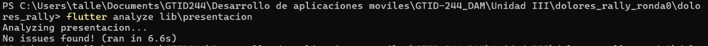

### Captura 19 · Análisis del radar

El radar se analiza sin errores.

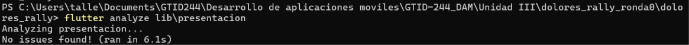

### Captura 20 · Ajuste de la pantalla del juego

Se importa `radar.dart` en `pantalla_rally.dart` para usar el texto de la temperatura, y el análisis queda sin errores.

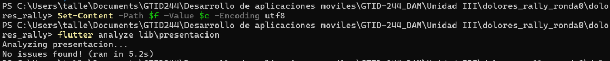

### Captura 21 · Análisis de las pantallas

El análisis del proyecto completo, con el único aviso de estilo en las pruebas de la partida.

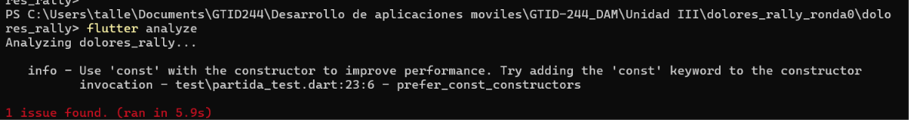

### Captura 22 · Pantalla de inicio en el teléfono

Menú principal con las opciones de GPS real, modo demo y álbum.

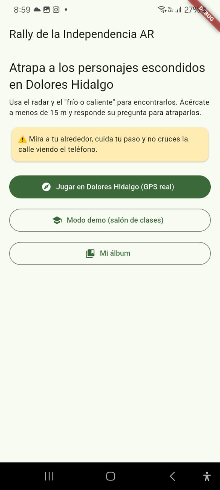

### Captura 23 · Juego en modo demo

Personajes sobre la vista de la cámara, el radar en la esquina y el marcador con la temperatura.

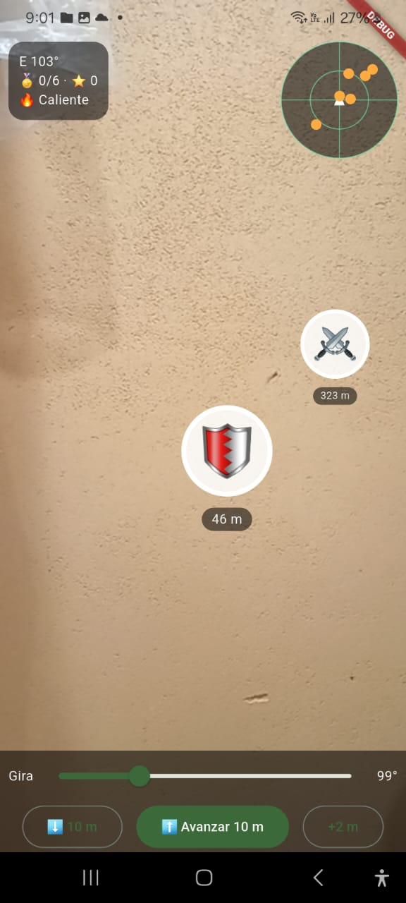

### Captura 24 · Aviso de personaje que se escapa

Al fallar dos veces, el personaje huye y aparece un aviso.

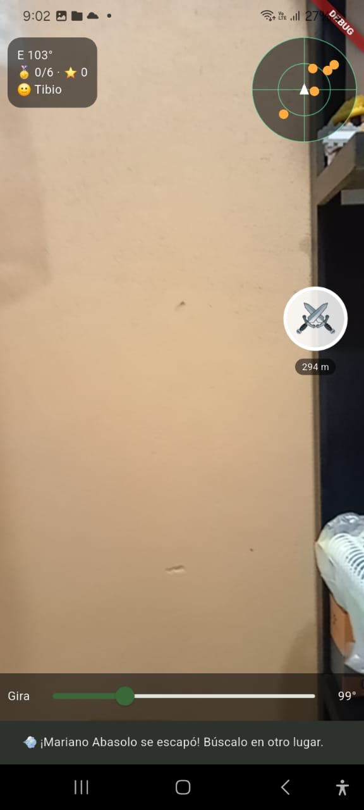

### Captura 25 · Pregunta de Mariano Abasolo

Al tocar un personaje cercano aparece su pregunta de historia.

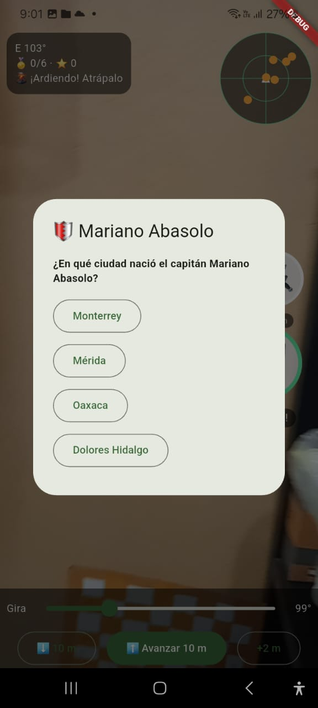

### Captura 26 · Pregunta de Josefa Ortiz de Domínguez

Cada personaje tiene su propia pregunta.

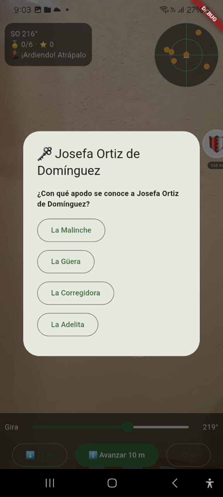

### Captura 27 · Personaje que se escapa

Tras dos respuestas incorrectas, Josefa Ortiz de Domínguez se escapa y reaparece en otro lugar.

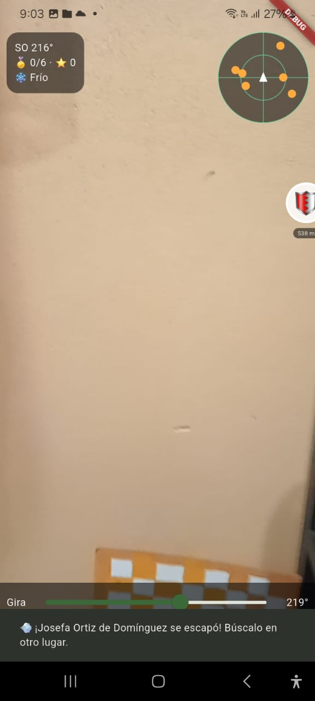

### Captura 28 · Permiso de ubicación

Al elegir el modo con GPS real, la app pide permiso para usar la ubicación.

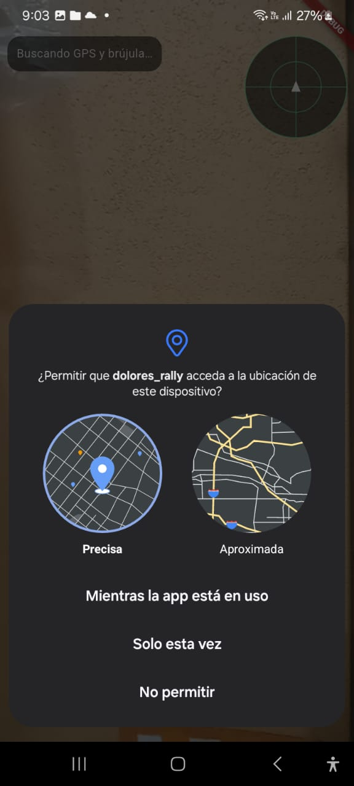

### Captura 29 · Mi álbum

El álbum muestra los personajes por descubrir y el mejor puntaje.

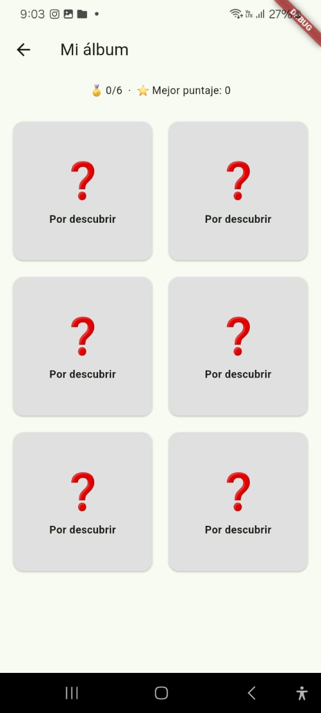

### Captura 30 · Respuesta incorrecta

Al responder mal, la app avisa cuántos intentos quedan.

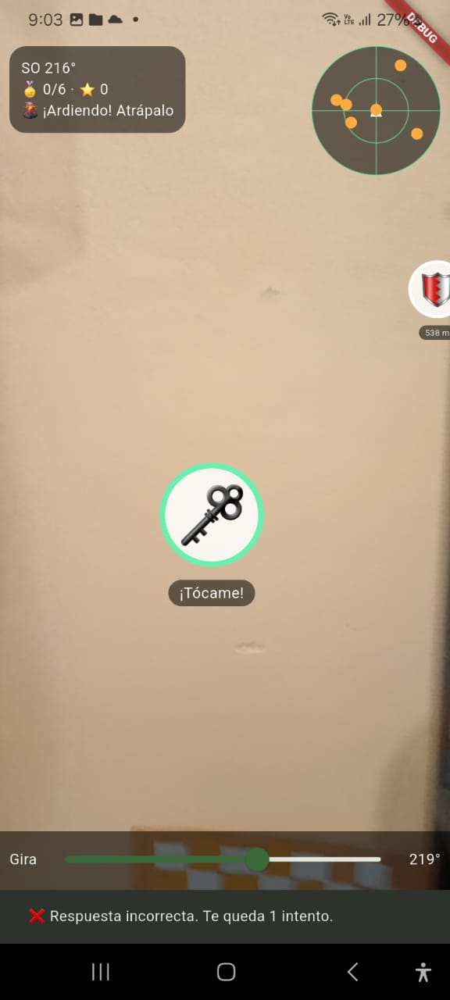

## Notas de diseño

- Las coordenadas del punto de partida (Jardín Principal) y de los personajes son aproximadas, para práctica. Verifícalas con fuentes históricas y con un recorrido de campo antes de usar el juego con visitantes.
- El modo demo usa un almacén en memoria, por lo que no modifica el progreso real del álbum.
- Las pruebas no necesitan teléfono, cámara ni GPS. Lo visual se verifica en el dispositivo.
