# Dolores Hoy · Tablero con 5 APIs y buenas prácticas de seguridad

Aplicación Flutter que muestra en un solo tablero información de Dolores Hidalgo, Guanajuato, obtenida de cinco APIs gratuitas: clima, tipo de cambio, días festivos, Wikipedia y la foto astronómica del día de la NASA. Se desarrolla con TDD (primero las pruebas en rojo, después el código en verde) y aplica prácticas de seguridad: HTTPS obligatorio, claves fuera del código, validación de entradas y salidas, y errores que no filtran información. Corresponde al manual *Manual paso a paso con TDD · Dolores Hoy*.

## Requisitos

- Flutter 3.x (`flutter --version`)
- Dart 3.x (incluido con Flutter)
- Android (celular con depuración USB) o Chrome/Edge para pruebas
- Conexión a internet para consumir las APIs reales

## Configuración

Las claves nunca se escriben en el código. Crea el archivo `secrets.json` en la raíz del proyecto a partir de la plantilla:

```powershell
Copy-Item secrets.json.example secrets.json
```

Después reemplaza `DEMO_KEY` por tu clave personal de api.nasa.gov. El archivo `secrets.json` está en `.gitignore` y no se sube al repositorio.

## Ejecutar

```powershell
flutter pub get
flutter test
flutter run -d NOMBRE_DEL_DISPOSITIVO --dart-define-from-file=secrets.json
```

## Las 5 APIs

| # | API | Dirección base | Clave | Qué muestra |
|---|---|---|---|---|
| 1 | Open-Meteo | `api.open-meteo.com` | No | Clima actual en Dolores Hidalgo |
| 2 | Frankfurter | `api.frankfurter.dev` | No | Tipo de cambio (1 USD y 1 EUR en pesos) |
| 3 | Nager.Date | `date.nager.at` | No | Próximos días festivos de México |
| 4 | Wikipedia | `es.wikipedia.org` | No | Resumen de Dolores Hidalgo |
| 5 | NASA APOD | `api.nasa.gov` | Sí | Foto astronómica del día |

## Arquitectura

```
lib/
├── dominio/       excepciones.dart · modelos.dart
├── datos/         cliente_seguro.dart · config_claves.dart · servicios.dart
├── presentacion/  tablero_viewmodel.dart · pantalla_tablero.dart
└── main.dart
```

`ClienteSeguro` es la única puerta de salida a internet: rechaza `http://`, aplica timeout de 8 segundos, limita el tamaño de la respuesta y valida el JSON.

## Pruebas y evidencias

Las capturas siguen el orden del desarrollo: primero el rojo (la prueba falla), después el verde (la prueba pasa).

### Ronda 1 · Conociendo las 5 APIs

Se prueba cada URL en el navegador para conocer el formato de la respuesta antes de programar.

### Captura 1 · Clima (Open-Meteo)

La respuesta incluye el bloque `current` con `temperature_2m: 17.1` y `weather_code: 1`.

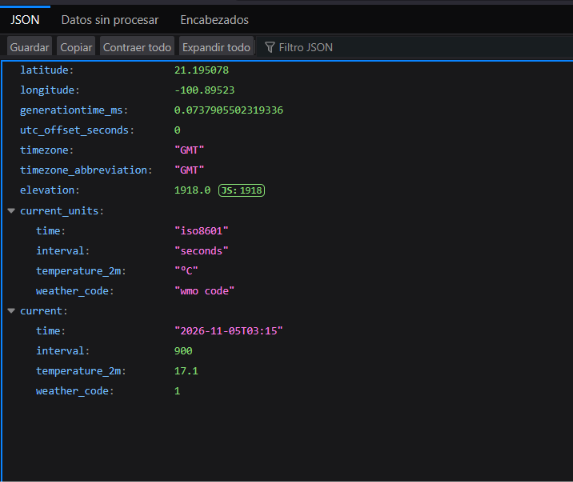

### Captura 2 · Tipo de cambio (Frankfurter)

Con `base: MXN`, la API devuelve las tasas de USD y EUR. La app calcula el inverso para mostrar cuántos pesos cuesta un dólar.

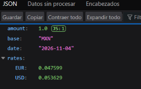

### Captura 3 · Días festivos (Nager.Date)

Lista de festivos oficiales de México para 2026, con los campos `date` y `localName`.

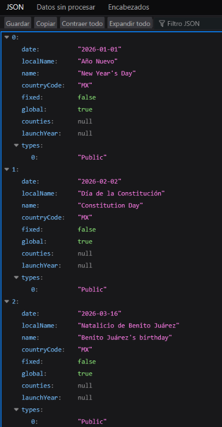

### Captura 4 · Festivos de Semana Santa y mayo

Parte de la misma respuesta, con los festivos de abril y mayo.

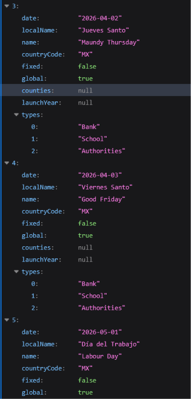

### Captura 5 · Festivos de septiembre a diciembre

Parte final de la respuesta, con la Independencia, la Revolución y la Navidad.

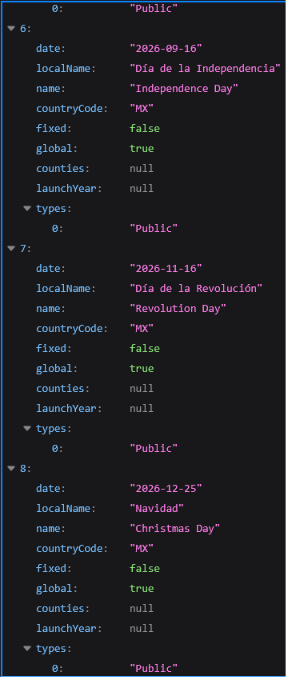

### Captura 6 · Resumen de Wikipedia

Respuesta del resumen de Dolores Hidalgo, con el título, el extracto y la miniatura en `https`.

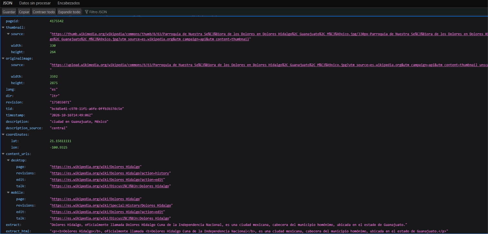

### Captura 7 · NASA APOD con error 500

Al consultar la API de la NASA, la respuesta fue un error del servidor. La app lo mostrará como mensaje genérico en su tarjeta, sin afectar a las demás.

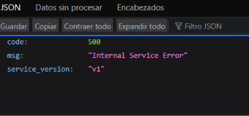

### Ronda 2 · Cimientos seguros: el cliente HTTP

### Captura 8 · Prueba roja del cliente

`flutter test test/cliente_seguro_test.dart` falla porque `cliente_seguro.dart` todavía no existe.

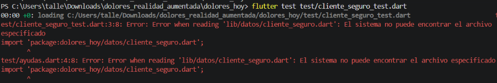

### Captura 9 · Prueba roja, resultado final

Las 11 pruebas del cliente no se ejecutan; la terminal muestra `Some tests failed`.

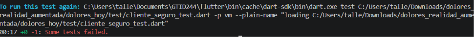

### Captura 10 · Prueba verde del cliente

Con `cliente_seguro.dart` implementado, las 11 pruebas pasan.

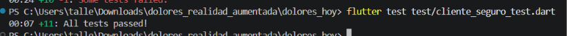

### Ronda 3 · API 1: Clima

### Captura 11 · Prueba roja del clima

Faltan `config_claves.dart`, `servicios.dart` y `modelos.dart`, por lo que la prueba falla.

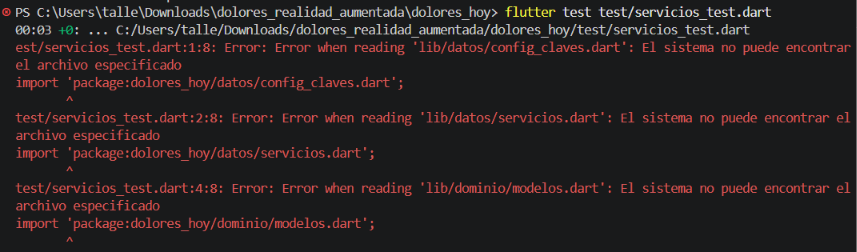

### Captura 12 · Prueba roja, resultado final

La ejecución termina con `Some tests failed`.

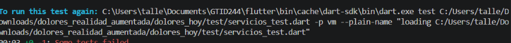

### Captura 13 · Prueba roja con `config_claves.dart` creado

Ya no falta la configuración; los errores restantes son de `servicios.dart` y `modelos.dart`.

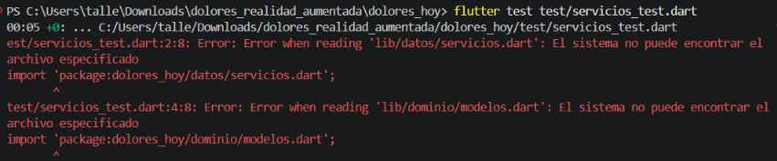

### Captura 14 · Resultado de la prueba roja

Confirmación de que la prueba del clima sigue fallando antes de implementar el modelo.

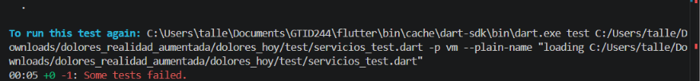

### Captura 15 · Análisis del modelo `Clima`

`flutter analyze lib/dominio/modelos.dart` no reporta problemas.

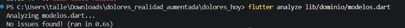

### Captura 16 · Prueba verde del clima

Las 4 pruebas del clima pasan: conversión de la respuesta, validación de coordenadas, JSON incompleto y traducción de códigos.


### Ronda 4 · API 2: Tipo de cambio

### Captura 17 · Prueba roja del tipo de cambio

La prueba falla porque `ServicioCambio` todavía no existe.

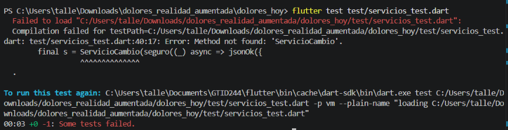

### Captura 18 · Prueba verde del tipo de cambio

Las 5 pruebas del archivo pasan, incluida la del tipo de cambio.

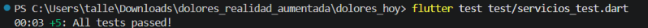

### Ronda 5 · API 3: Días festivos

### Captura 19 · Error de estructura al agregar el grupo de pruebas

Al pegar el grupo de festivos, una llave quedó sin cerrar y Dart marcó error en la estructura del archivo. Se corrigió reemplazando el archivo completo.

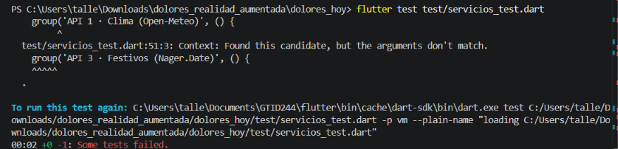

### Captura 20 · Segundo intento con el mismo error

Confirmación del error de estructura antes de la corrección.

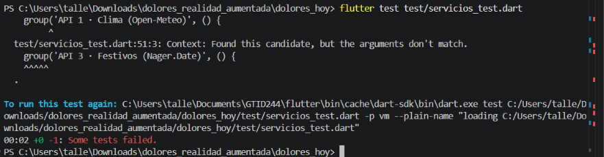

### Captura 21 · Prueba verde de los festivos

Las 8 pruebas del archivo pasan: clima, tipo de cambio y festivos.

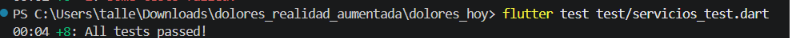

### Ronda 6 · API 4: Wikipedia

### Captura 22 · Prueba roja de Wikipedia

La prueba falla porque `ServicioWikipedia` no existe. Incluye la validación contra inyección de ruta con `../../admin`.

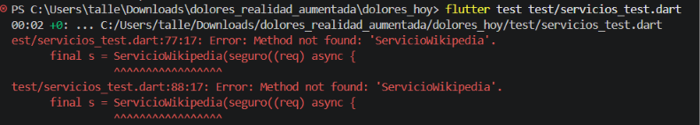

### Captura 23 · Prueba verde de Wikipedia

Las 12 pruebas del archivo pasan.

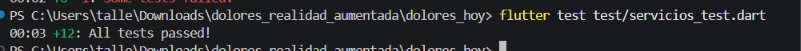

### Ronda 7 · API 5: NASA y manejo seguro de claves

### Captura 24 · Pruebas de seguridad

`seguridad_test.dart` verifica que `ConfigClaves` oculte la clave, que los errores inesperados no filtren detalles internos y que solo se acepten miniaturas `https`. Las 7 pruebas pasan.

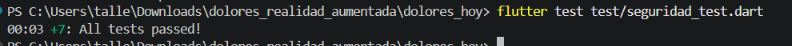

### Captura 25 · Prueba roja del servicio NASA

La prueba falla porque `ServicioNasa` y `FotoAstronomica` todavía no existen.

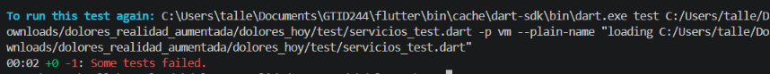

### Captura 26 · Prueba verde del servicio NASA

Las 17 pruebas de servicios pasan: clima, tipo de cambio, festivos, Wikipedia y NASA.

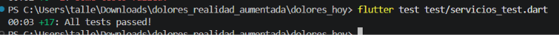

### Ronda 8 · El tablero

### Captura 27 · Prueba roja del ViewModel

`tablero_viewmodel_test.dart` falla porque `TableroViewModel` todavía no existe.

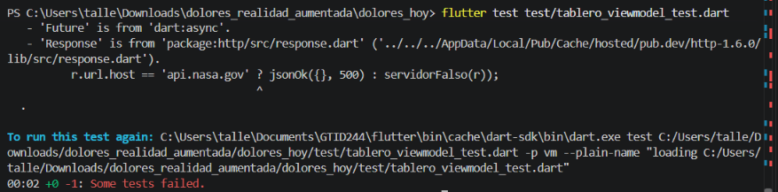

### Captura 28 · Prueba verde del ViewModel

Las 4 pruebas del tablero pasan: carga de las 5 tarjetas, aislamiento de fallas, error sin internet y estado de carga.

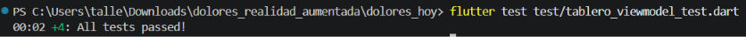

### Ronda 9 · La pantalla y la prueba final

### Captura 29 · Tablero en el celular

La app corriendo en un dispositivo Android con las cinco tarjetas cargadas con datos reales de las APIs.

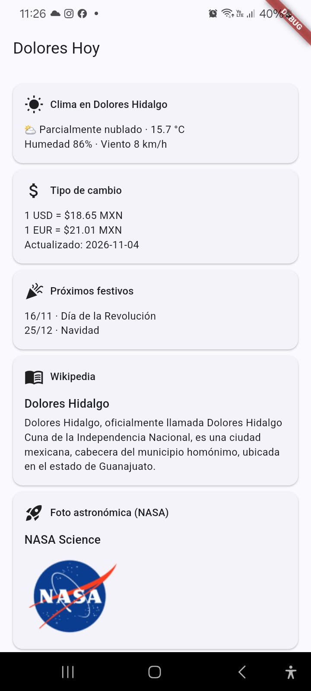

### Captura 30 · Prueba sin internet

Con el modo avión activado, cada tarjeta muestra el mensaje `No hay conexión con el servidor. Revisa tu internet.` y la app no se cierra.

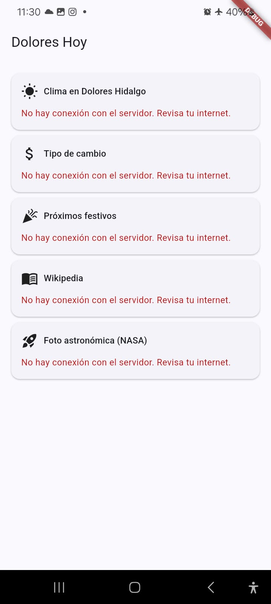

## Estructura del proyecto

```
dolores_hoy/
├── lib/
├── test/
├── docs/
│   └── capturas/
├── secrets.json.example
├── pubspec.yaml
└── README.md
```
