# Nieves 2048

Juego de fusión de números en el que cada valor es un sabor de nieve de Dolores Hidalgo. Este repositorio contiene la lógica del juego, construida con TDD (Test-Driven Development) en Dart puro, junto con sus pruebas.

## Sabores

| Valor | Sabor |
|-------|-------|
| 2 | Vainilla |
| 4 | Fresa |
| 8 | Chocolate |
| 16 | Mango |
| 32 | Limón |
| 64 | Uva |
| 128 | Mole |
| 256 | Tequila |
| 512 | Café |
| 1024 | Rompope |
| 2048 | ¡Independencia! (ficha ganadora) |

## Reglas

- Al deslizar en una dirección, las fichas se mueven hasta topar con el borde o con otra ficha.
- Dos fichas iguales que chocan se fusionan en una sola con el doble de valor, una sola vez por movimiento.
- Tras cada movimiento que desplaza fichas, aparece una nueva nieve (90 % Vainilla, 10 % Fresa) en una celda vacía.

## Estructura del proyecto

La carpeta `lib/logica/` es Dart puro, sin imports de Flutter, lo que permite probar el algoritmo en milisegundos.

```
nieves_2048
│   pubspec.yaml
│   README.md
├───lib
│   └───logica
│           direccion.dart
│           estado_juego.dart
│           grid.dart
│           motor_2048.dart
│           motor_juego.dart
└───test
        grid_test.dart
        motor_2048_test.dart
        motor_juego_test.dart
```

Captura: `capturas/01_estructura.png`

## Requisitos

- Flutter 3.47.2 (canal stable) con Dart 3.13.2

Captura: `capturas/02_version_flutter.png`

```
flutter --version
```

## Cómo ejecutar las pruebas

1. Instalar dependencias:

```
flutter pub get
```

Salida esperada: termina con `Got dependencies!`. El aviso sobre paquetes con versiones nuevas no impide ejecutar el proyecto.

Captura: `capturas/03_pub_get.png`

2. Ejecutar las pruebas:

```
flutter test
```

Salida esperada: `All tests passed!` con el contador `+20`.

Captura: `capturas/04_flutter_test.png`

3. Ver el detalle de cada prueba:

```
flutter test --reporter expanded
```

Captura: `capturas/05_flutter_test_expanded.png`

## Pruebas

| Ronda | Archivo | Prueba |
|-------|---------|--------|
| 1 | `motor_2048_test.dart` | compactarFila quita los huecos y mantiene el orden |
| 1 | `motor_2048_test.dart` | compactarFila sin huecos no cambia nada |
| 2 | `motor_2048_test.dart` | fusionarFila combina un par adyacente igual |
| 2 | `motor_2048_test.dart` | fusionarFila no fusiona tres iguales seguidos más de una vez |
| 3 | `motor_2048_test.dart` | mover una fila hacia la izquierda compacta y fusiona correctamente |
| 3 | `motor_2048_test.dart` | una fila ya en su posición final reporta seMovio en falso |
| 4 | `grid_test.dart` | moverIzquierda aplica el movimiento a las 4 filas |
| 5 | `grid_test.dart` | moverDerecha empuja las fichas hacia el lado opuesto |
| 6 | `grid_test.dart` | moverArriba empuja las fichas de cada columna hacia arriba |
| 6 | `grid_test.dart` | moverAbajo empuja las fichas de cada columna hacia abajo |
| 7 | `grid_test.dart` | agregarFichaAleatoria coloca exactamente una ficha nueva |
| 7 | `grid_test.dart` | agregarFichaAleatoria no hace nada si la cuadrícula está llena |
| 8 | `grid_test.dart` | hayMovimientosPosibles es verdadero si hay una celda vacía |
| 8 | `grid_test.dart` | hayMovimientosPosibles es verdadero si hay una fusión posible |
| 8 | `grid_test.dart` | hayMovimientosPosibles es falso si la cuadrícula está llena y sin fusiones |
| 9 | `grid_test.dart` | haGanado es verdadero cuando una celda alcanza el objetivo |
| 9 | `grid_test.dart` | haGanado es falso si ninguna celda alcanza el objetivo |
| 10 | `motor_juego_test.dart` | mover sin ningún desplazamiento no agrega una ficha nueva |
| 10 | `motor_juego_test.dart` | alcanzar el valor objetivo cambia el estado a ganado |
| Integración | `motor_juego_test.dart` | una serie de movimientos combina fichas y acumula puntaje |

Total: **20 pruebas**, todas en verde.

## Ciclo TDD seguido

Cada funcionalidad se construyó en rondas de rojo, verde y refactor:

1. **Ronda 1:** compactar una fila (quitar huecos).
2. **Ronda 2:** fusionar pares adyacentes iguales, sin fusionar tres fichas iguales seguidas más de una vez.
3. **Ronda 3:** mover una fila completa hacia la izquierda.
4. **Ronda 4:** mover la cuadrícula completa hacia la izquierda.
5. **Ronda 5:** mover hacia la derecha reutilizando la lógica de la izquierda.
6. **Ronda 6:** mover arriba y abajo transponiendo la cuadrícula.
7. **Ronda 7:** agregar una ficha nueva al azar (con `Random` inyectable para pruebas deterministas).
8. **Ronda 8:** detectar si ya no hay movimientos posibles.
9. **Ronda 9:** detectar la victoria.
10. **Ronda 10:** `MotorJuego` integra puntaje, turnos y estados de victoria/derrota.

### Evidencia de cada ronda (rojo → verde)

En cada ronda primero se escribió la prueba y se ejecutó `flutter test` para verla fallar (🔴); después se escribió el código mínimo y se volvió a ejecutar hasta verla pasar (🟢). Un error de compilación por código inexistente también cuenta como prueba en rojo.

#### Ronda 1 — Compactar una fila

🔴 Rojo: `capturas/r01_rojo.png`

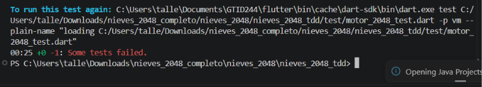

🟢 Verde (`+2`): `capturas/r01_verde.png`

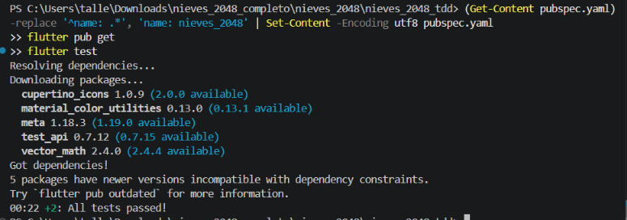

#### Ronda 2 — Fusionar pares adyacentes

🔴 Rojo: `capturas/r02_rojo.png`

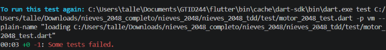

🟢 Verde (`+4`): `capturas/r02_verde.png`

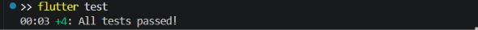

#### Ronda 3 — Mover una fila a la izquierda

🔴 Rojo: `capturas/r03_rojo.png`

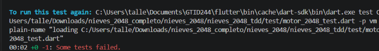

🟢 Verde (`+6`): `capturas/r03_verde.png`

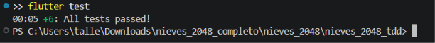

#### Ronda 4 — Mover la cuadrícula a la izquierda

🔴 Rojo: `capturas/r04_rojo.png`

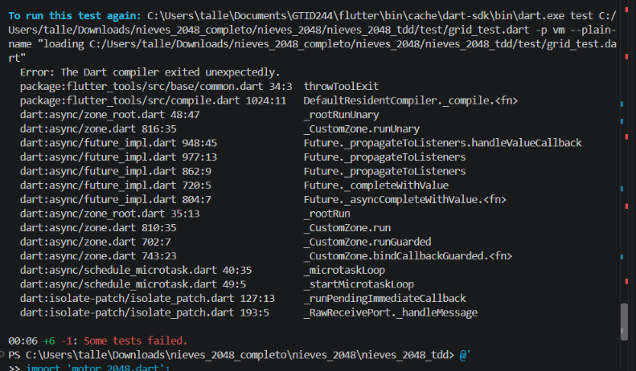

🟢 Verde (`+7`): `capturas/r04_verde.png`

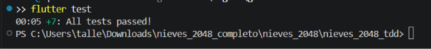

#### Ronda 5 — Mover a la derecha

🔴 Rojo: `capturas/r05_rojo.png`

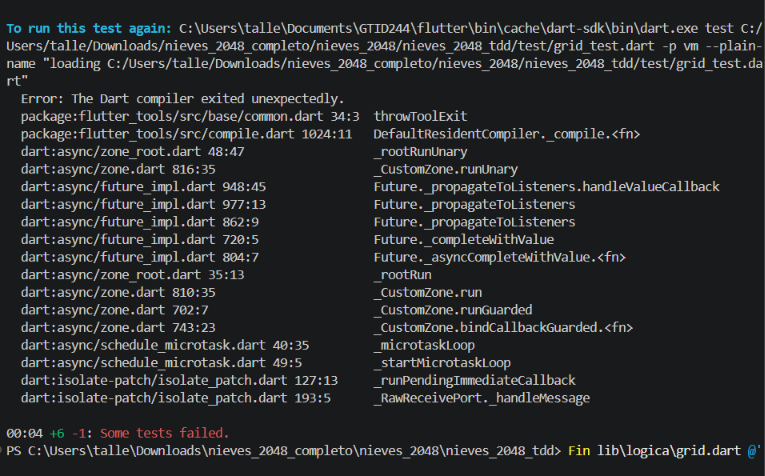

🟢 Verde (`+8`): `capturas/r05_verde.png`

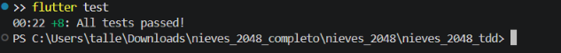

#### Ronda 6 — Mover arriba y abajo

🔴 Rojo: `capturas/r06_rojo.png`

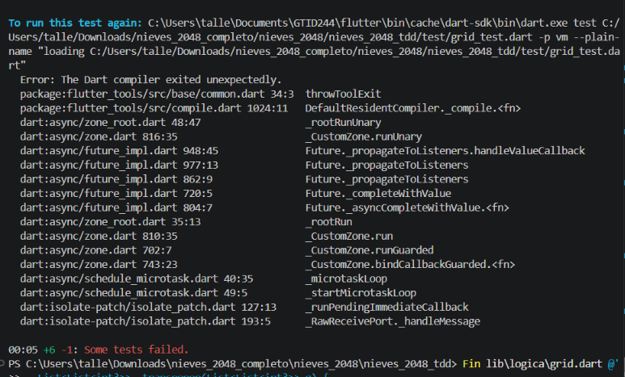

🟢 Verde (`+10`): `capturas/r06_verde.png`

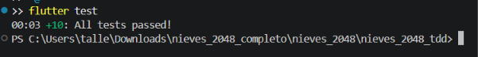

#### Ronda 7 — Agregar ficha aleatoria

🔴 Rojo: `capturas/r07_rojo.png`

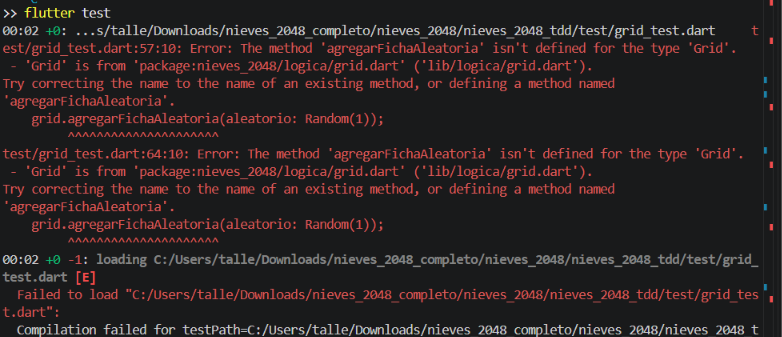

🟢 Verde (`+12`): `capturas/r07_verde.png`

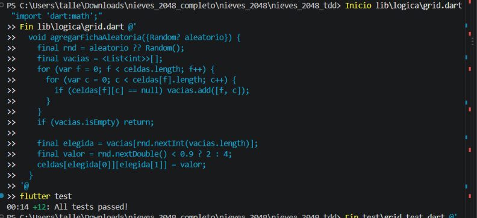

#### Ronda 8 — Detectar movimientos posibles

🔴 Rojo: `capturas/r08_rojo.png`

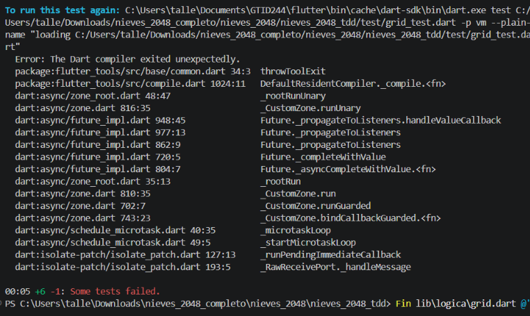

🟢 Verde (`+15`): `capturas/r08_verde.png`

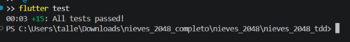

#### Ronda 9 — Detectar la victoria

🔴 Rojo: `capturas/r09_rojo.png`

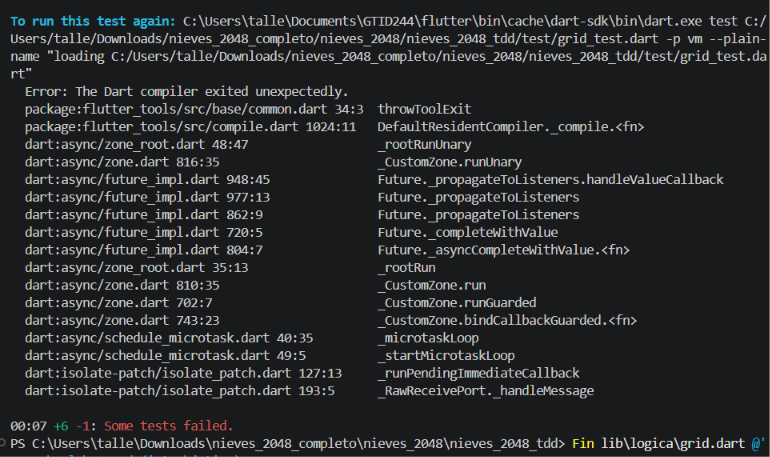

🟢 Verde (`+17`): `capturas/r09_verde.png`

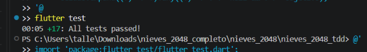

#### Ronda 10 — MotorJuego (integración)

🔴 Rojo: `capturas/r10_rojo.png`

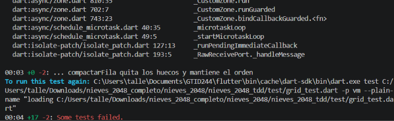

🟢 Verde (`+20`): `capturas/r10_verde.png`

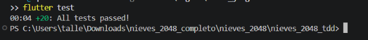

