# Tanda Dolorena

Sistema de ahorro rotativo vecinal, construido con TDD siguiendo el Manual TDD.

## Estructura

- `lib/logica/servicio_tanda.dart`: reglas de negocio (Dart puro, sin Flutter).
- `lib/modelos/`: entidades `Participante`, `Tanda`, `CierreRonda`.
- `lib/presentation/tanda_screen.dart`: interfaz animada.
- `test/servicio_tanda_test.dart`: 12 pruebas (una por regla, más una de integración).
- `evidencia/`: capturas de rojo y verde por ronda, y el ciclo TDD documentado.

## Ejecutar

```bash
flutter pub get
flutter test
flutter run
```

## Ciclo TDD por ronda

Cada ronda se verificó en dos pasos: primero se rompió la regla y la prueba falló (rojo), después se restauró el código y la prueba pasó (verde).

| Ronda | Regla | Rojo | Verde |
|---|---|---|---|
| 1 | Registrar una aportación válida | 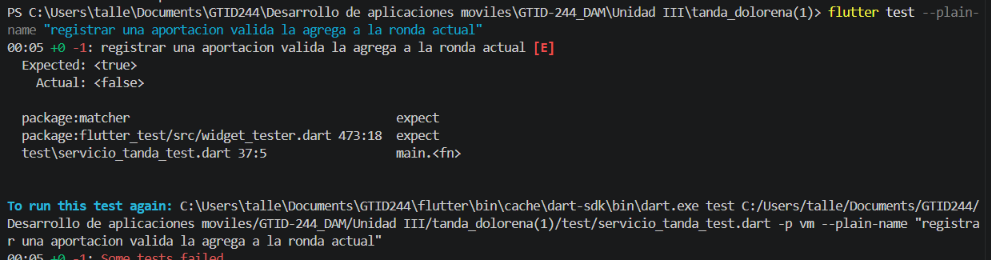 | 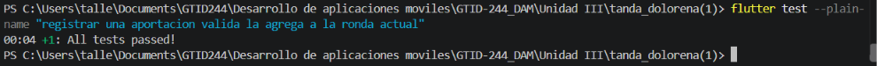 |
| 2 | No aportar dos veces en la misma ronda | 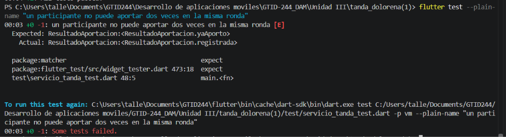 | 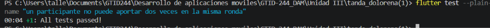 |
| 3 | Solo participantes pueden aportar | 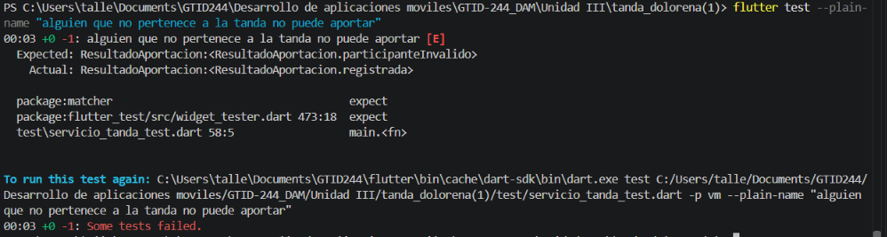 | 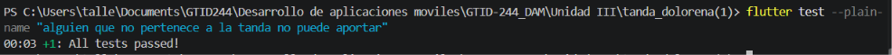 |
| 4 | `puedeCerrarRonda` solo con todos los aportes | 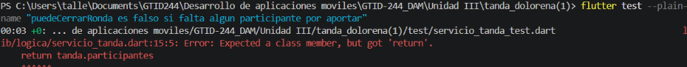 | 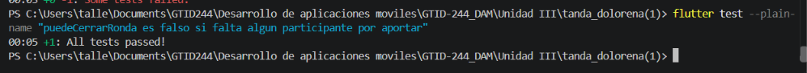 |
| 5 | Cerrar ronda entrega turno y avanza | 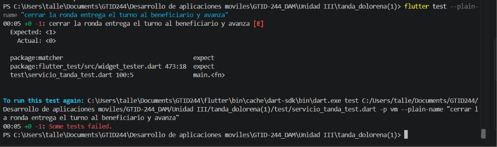 | 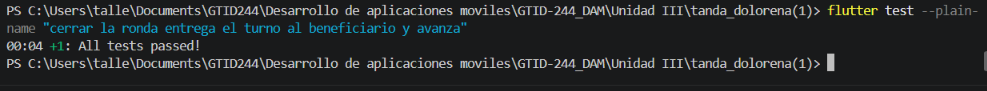 |
| 6 | No cerrar si faltan aportaciones | 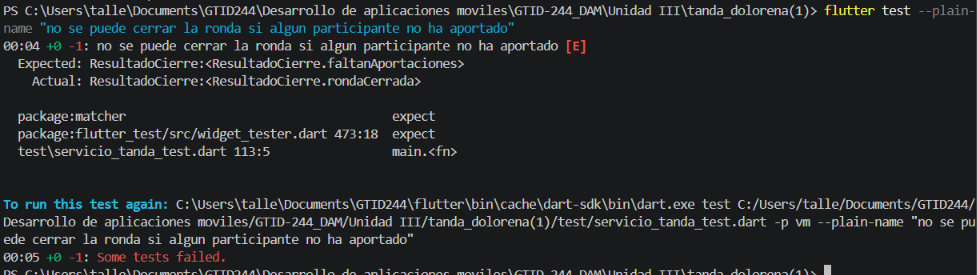 | 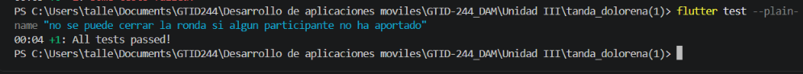 |
| 7 | La tanda termina (`haTerminado`) | 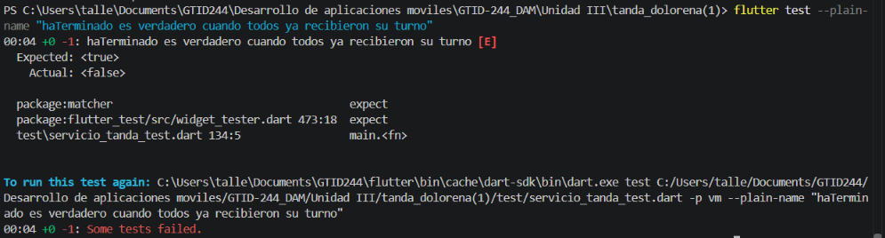 | PENDIENTE |
| Extra | Cerrar tanda terminada sin error | 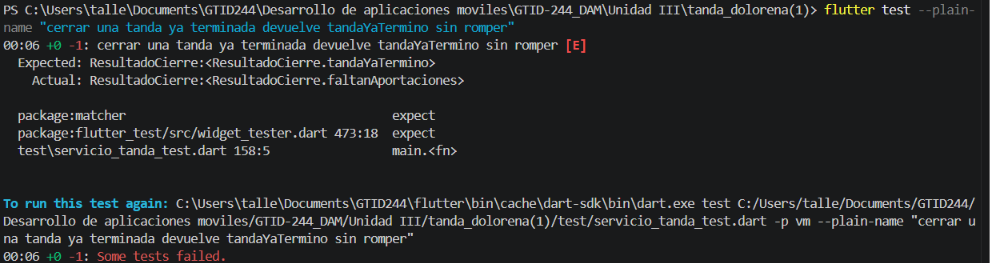 | 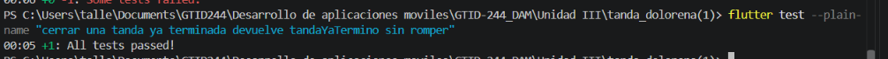 |

## Resultado final

Las 12 pruebas pasan:

```
00:11 +12: All tests passed!
```
