# Punto de Venta Dolores · TDD con Flutter + SQLite

Reporte de evidencias · Desarrollo Móvil Integral · UTNG

| | |
|---|---|
| **Alumno** | Camacho Gómez |
| **Grupo** | GTID244 |
| **Fecha** | 27/10/2026 |

## Descripción

Punto de venta para negocios de Dolores Hidalgo (nieves, dulces, cerámica, etc.) construido con **TDD (Test-Driven Development)**: cada regla de negocio nació de una prueba en ROJO y se hizo pasar a VERDE con el mínimo código necesario.

- **Flutter** para la interfaz.
- **SQLite local** (`sqflite`) para guardar productos y ventas.
- **Dominio en Dart puro**, probado sin Flutter ni base de datos.
- **Transacción** al cobrar: se guarda la venta y se descuenta el inventario, o no se hace nada.

## Reglas de diseño

- Todo el dinero se maneja en **centavos enteros** (`int`), nunca con `double`.
- El dominio (`lib/dominio`) no importa Flutter ni sqflite.
- Los errores técnicos se traducen a excepciones de negocio con mensaje claro.
- La pantalla no contiene reglas de negocio; las usa a través del ViewModel.

## Estructura del proyecto

```
lib/
  dominio/        reglas del negocio (Dart puro)
  datos/          SQLite: base de datos y repositorios
  presentacion/   ViewModel y pantalla de caja
  main.dart       arranque de la app
test/
  dominio_test.dart   11 pruebas
  datos_test.dart      6 pruebas
docs/capturas/        evidencias de este reporte
```

## Cómo ejecutar

Pruebas (17 en total):

```bash
flutter pub get
flutter test
```

App (con un emulador o teléfono Android conectado):

```bash
flutter devices
flutter run
```

## Resumen de la evidencia

| Ronda | Tema | Capturas |
|---|---|---|
| 0 | Preparar el taller | 1 a 3 |
| 1 | El dinero | 4 a 8 |
| 2 | El Producto | 9 y 10 |
| 3 | El Carrito | 11 a 18 |
| 4 | Base de datos SQLite | 19 y 20 |
| 5 | Cobrar y transacción | 21 a 25 |
| 6 | ViewModel y pantalla | 26 a 28 |
| Cierre | Todo en verde | 29 |

---

## Ronda 0 · Preparar el taller

### Captura 1 · Estructura del proyecto

Carpetas `lib/datos`, `lib/dominio`, `lib/presentacion`, `test` y los archivos `pubspec.yaml` y `README.md`.

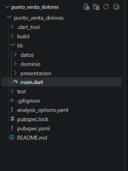

### Captura 2 · Dependencias instaladas

`flutter pub get` resuelve y descarga las dependencias del proyecto.

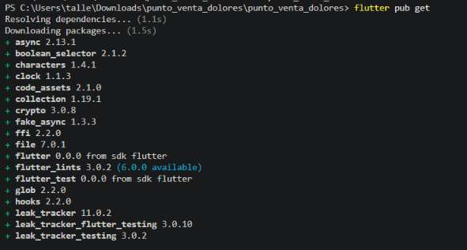

### Captura 3 · Taller limpio

`flutter test` avisa que la carpeta `test` aún no tiene archivos de prueba. Se parte de cero.

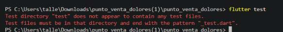

## Ronda 1 · El dinero: la regla de oro

### Captura 4 · ROJO: formatear pesos

`flutter test` falla porque `dinero.dart` todavía no existe.

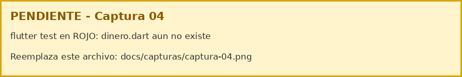

### Captura 5 · VERDE: formatear pesos

Con `formatearPesos` creada, la prueba `formatea centavos` pasa (+1).

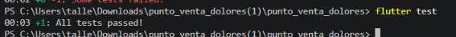

### Captura 6 · ROJO: texto a centavos

Las pruebas `convierte texto a centavos` y `rechaza texto inválido` fallan: `Method not found: 'pesosACentavos'`.

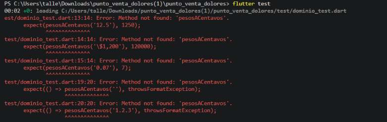

### Captura 7 · VERDE: dinero completo

Con `pesosACentavos` implementada pasan las 3 pruebas del grupo Dinero (+3).

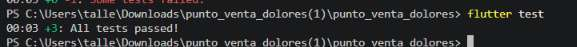

### Captura 8 · Reto de la ronda 1 (opcional)

No se realizó.

## Ronda 2 · El Producto

### Captura 9 · ROJO: Producto

El archivo `lib/dominio/producto.dart` no existe, así que la prueba no compila.

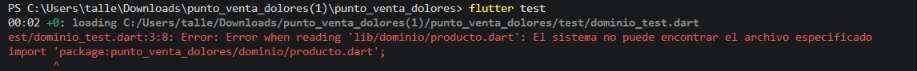

### Captura 10 · VERDE: Producto

Con `Producto` creado pasan `ida y vuelta a mapa` y `copiarCon`: 5 pruebas en total (+5).

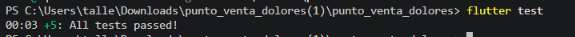

## Ronda 3 · El Carrito

### Captura 11 · ROJO ciclo 3.1: sumar cantidades

`carrito.dart` no existe: `Method not found: 'Carrito'`.

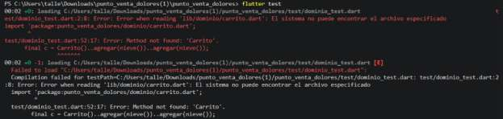

### Captura 12 · VERDE ciclo 3.1

Con la versión 1 del carrito, `suma cantidades del mismo producto` pasa (+6).

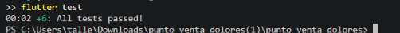

### Captura 13 · ROJO ciclo 3.2: no vender lo que no hay

`no excede existencias` falla: se esperaba `ExistenciasInsuficientesException` y no se lanzó nada.

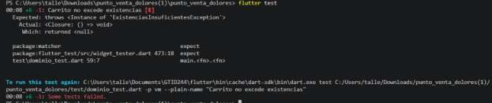

### Captura 14 · VERDE ciclo 3.2

Con la validación en `agregar`, la prueba pasa (+7).

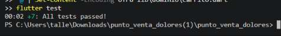

### Captura 15 · ROJO ciclo 3.3: IVA

`desglosa IVA 16% del total` falla: no existen los getters `ivaCentavos` y `subtotalCentavos`.

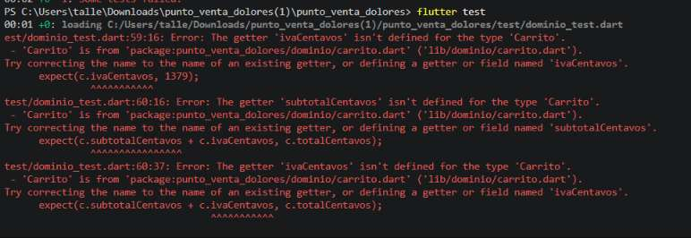

### Captura 16 · VERDE ciclo 3.3

Con el IVA implementado (1379 centavos sobre $100.00) pasa la prueba (+8).

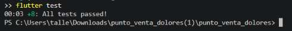

### Captura 17 · ROJO ciclo 3.4: cambio, pago corto y carrito vacío

Las tres pruebas fallan porque el método `cambio` no está definido en `Carrito`.

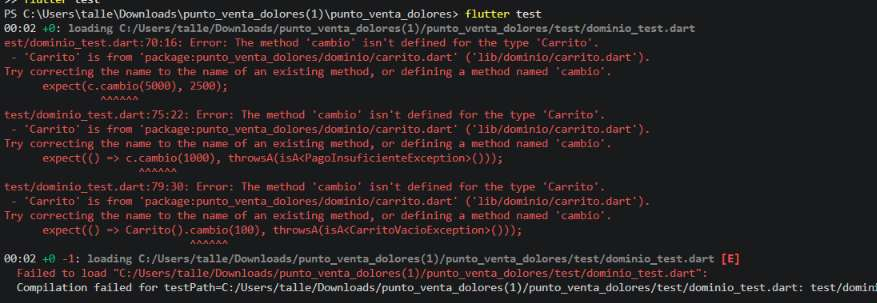

### Captura 18 · VERDE: 11 pruebas del dominio

Con `cambio` implementado pasan las 11 pruebas del dominio (3 de Dinero, 2 de Producto y 6 de Carrito).

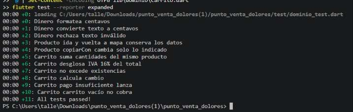

## Ronda 4 · Base de datos local SQLite

### Captura 19 · ROJO: guardar y buscar

`datos_test.dart` falla porque `repositorio_productos.dart` no existe: `'RepositorioProductos' isn't a type`.

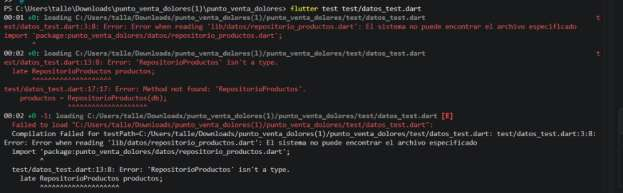

### Captura 20 · VERDE: guardar y buscar

Con el repositorio creado pasan `guarda y busca producto` y `código duplicado lanza excepción de dominio` (+2).

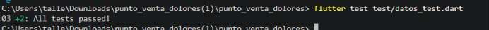

## Ronda 5 · Cobrar: la transacción

### Captura 21 · ROJO ciclo 5.1: cobrar descuenta inventario

`repositorio_ventas.dart` no existe: `'RepositorioVentas' isn't a type`.

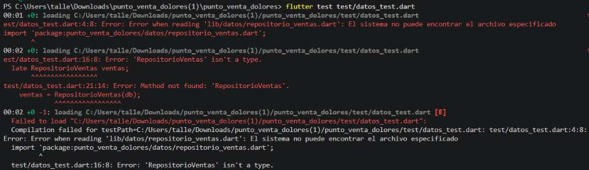

### Captura 22 · VERDE ciclo 5.1

Con `cobrar` implementado, la venta se registra y el inventario baja de 5 a 3 (+3).

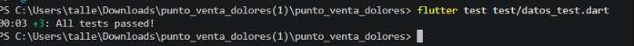

### Captura 23 · VERDE ciclo 5.2: la transacción protege el inventario

`si falla el cobro NO se descuenta inventario` pasa (+4). Si el pago es insuficiente, las existencias quedan intactas.

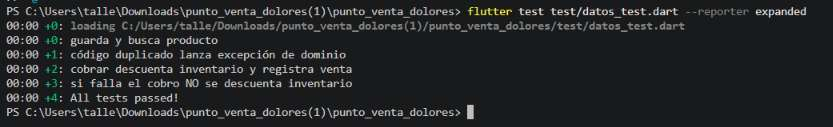

### Captura 24 · ROJO ciclo 5.3: corte del día

Las pruebas del corte fallan: `corteDelDia` no está definido en `RepositorioVentas`.

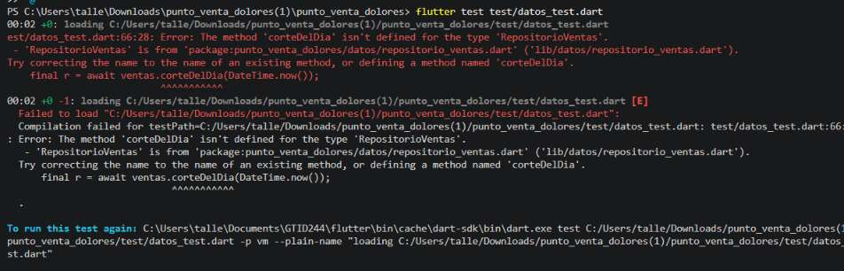

### Captura 25 · VERDE ciclo 5.3: pruebas de datos completas

Pasan las 6 pruebas de datos, incluidas `corte del día suma ventas de hoy` y `bajo inventario alerta`.

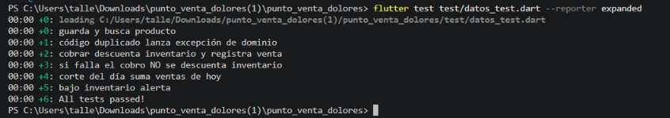

## Ronda 6 · ViewModel y pantalla

### Captura 26 · App corriendo

Pantalla "Caja · Dolores Hidalgo" con el catálogo de productos y el total en $0.00.

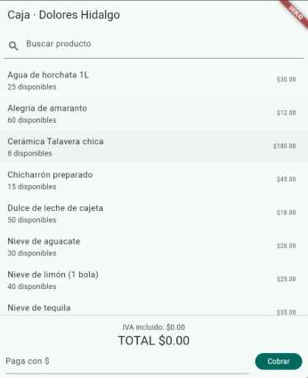

### Captura 27 · Carrito con productos

Después de tocar dos veces "Nieve de limón": `2 × Nieve de limón (1 bola)`, IVA incluido de $6.90 y TOTAL de $50.00.

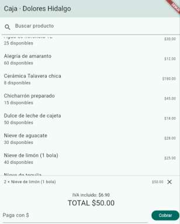

### Captura 28 · Cobro exitoso

Al pagar con $100 se muestra "Cambio: $50.00" y las existencias de la nieve de limón bajan a 38.

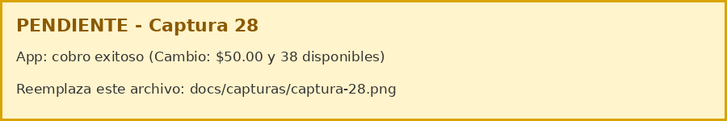

**Extra · validación de pago vacío:** si se toca Cobrar sin escribir el monto, la app muestra el mensaje de error y no registra la venta.

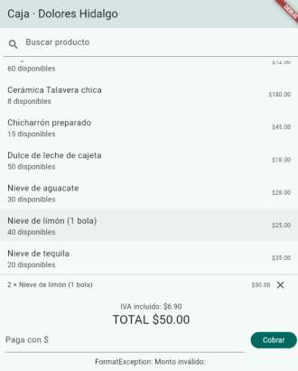

## Cierre · Todo en verde

### Captura 29 · flutter test completo

`flutter test` en la carpeta raíz del proyecto con las 17 pruebas pasando (11 de dominio y 6 de datos).

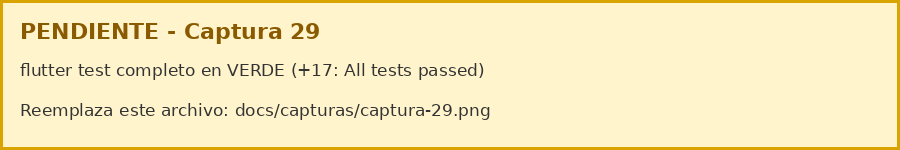
